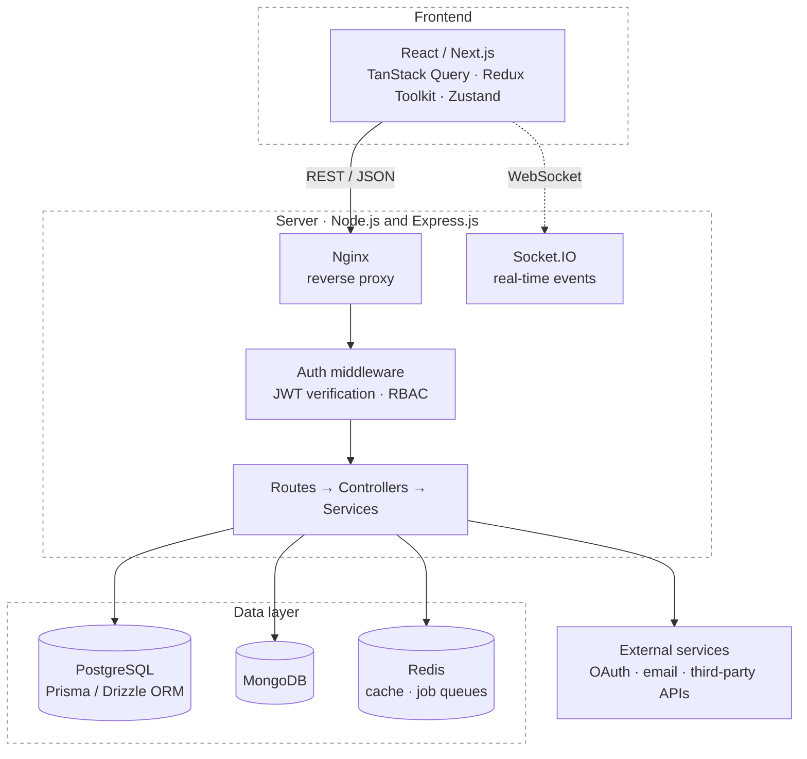
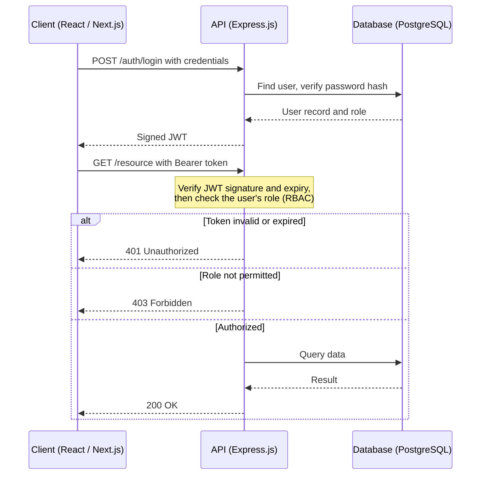
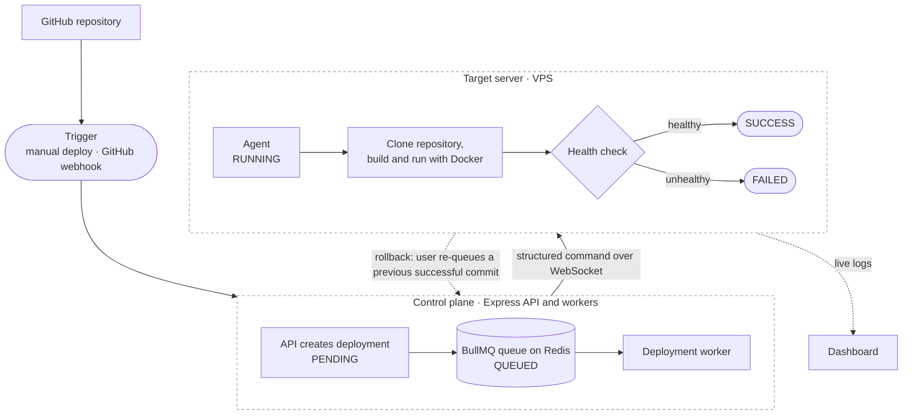

  

  <b>Full-Stack Developer</b> with nearly 2 years of experience building and deploying production web applications. 
  Open to remote Full-Stack, Frontend and Backend roles at junior-to-mid level.

  <a href="#about">About</a> &nbsp;·&nbsp;
  <a href="#technology-stack">Stack</a> &nbsp;·&nbsp;
  <a href="#featured-projects">Projects</a> &nbsp;·&nbsp;
  <a href="#architecture">Architecture</a> &nbsp;·&nbsp;
  <a href="#experience">Experience</a> &nbsp;·&nbsp;
  <a href="#contact">Contact</a>

## About

I build maintainable, production-ready web applications end to end: React and Next.js interfaces, Node.js APIs, database design and deployment. My core stack is TypeScript, React, Next.js, Node.js, Express.js and PostgreSQL.

Since April 2025 I have worked with a remote team at BBD Agency on production projects. They include an ISP management platform I co-built, which serves 1,000+ subscribers, and an e-commerce store and a training platform that I built independently. I also mentor four junior developers through code reviews, debugging and technical guidance.

I am looking for junior-to-mid-level roles with experienced engineering teams, preferably remote, where I can contribute and keep growing.

## Technology Stack

<b>Core stack</b> 

<b>Languages &amp; frontend</b> 

<b>Backend</b> 

<b>Databases &amp; ORM</b> 

<b>Authentication &amp; authorization</b> 

<b>DevOps &amp; infrastructure</b> 

<b>Tools</b> 

Express.js is my primary backend framework. NestJS is additional experience.

## Featured Projects

### WeWiFi: ISP Network and Subscriber Management Platform

A full-stack platform for managing ISP subscribers, PPPoE users, packages, invoices and support tickets.

- Manages 1,000+ subscribers
- MikroTik RouterOS integration, with router data refreshed automatically every three minutes
- Role-based access control with three permission levels
- Bilingual Arabic/English dashboards, with lazy loading and performance optimization

### Lina Store: E-commerce Platform

An Arabic e-commerce platform that I developed and deployed on my own.

- Product catalog, shopping cart, checkout and order management
- Admin dashboard
- Custom gift-box builder
- Deployed on a VPS with Docker and Nginx

### BBD Agency Website

A company website focused on responsive design, performance and SEO.

- Performance score improved from 70 to 97
- SEO score improved from 75 to 100

### BBD Select: Training Platform

A training platform that I designed and developed independently.

- Authentication and an admin dashboard
- Email integration and image uploads
- Structured application workflows

### DeployHub: Self-Hosted Deployment Platform

I built DeployHub to explore backend systems, deployment automation and DevOps. Users connect GitHub repositories, register their own servers and deploy applications with Docker.

- GitHub integration, including webhook-triggered deployments
- A lightweight agent on each server that receives structured deploy commands, with no arbitrary shell access
- Live deployment logs over Socket.IO
- Health checks, and rollback to a previous successful deployment
- Background job processing with BullMQ and Redis

## Architecture

Two of these diagrams are illustrative and one is specific to DeployHub. Each is labeled.

### Full-stack architecture

Illustrative: the kind of system I build, not the exact design of any single project. Each project uses the parts that fit it, for example PostgreSQL in WeWiFi and BBD Select, and MongoDB in Lina Store.

### Authentication and authorization flow

Illustrative: a typical JWT and role-based access control request flow, not the exact implementation of a specific project.

### DeployHub deployment workflow

Based on DeployHub's own architecture document. Rollback is started by the user and re-queues a previously successful commit.

## Experience

### Full-Stack Developer, BBD Agency

Remote team · April 2025 – Present

- Contributed to 5+ real-world projects
- Co-built the WeWiFi ISP management platform, which serves 1,000+ subscribers
- Built the Lina Store e-commerce platform independently, including cart, checkout, orders, an admin dashboard and a custom gift-box builder
- Improved the company website's performance score from 70 to 97 and its SEO score from 75 to 100
- Designed and developed the BBD Select training platform independently
- Mentor four junior developers through code reviews, debugging and technical guidance

### Software Engineering Experience, Areisto

April – July 2025

- Worked with Next.js, NestJS and TypeScript
- Worked with Domain-Driven Design practices
- Took part in Agile/Scrum development and code reviews

## Education

**B.Eng. in Computer Systems Engineering**, Al-Azhar University, Gaza

## Current Technical Interests

- Backend architecture and system design
- Deployment automation, Docker and DevOps
- Web performance and SEO
- Next.js App Router and server rendering patterns

## Contact

Open to remote Full-Stack, Frontend and Backend Developer roles at junior-to-mid level.

- Email: [husseinbux133@gmail.com](mailto:husseinbux133@gmail.com)
- Portfolio: [eng-hussein-m-portfolio.vercel.app](https://eng-hussein-m-portfolio.vercel.app/)
- LinkedIn: [linkedin.com/in/hussein-mohammed-eng](https://www.linkedin.com/in/hussein-mohammed-eng/)
- GitHub: [github.com/hussein-mo7](https://github.com/hussein-mo7)
